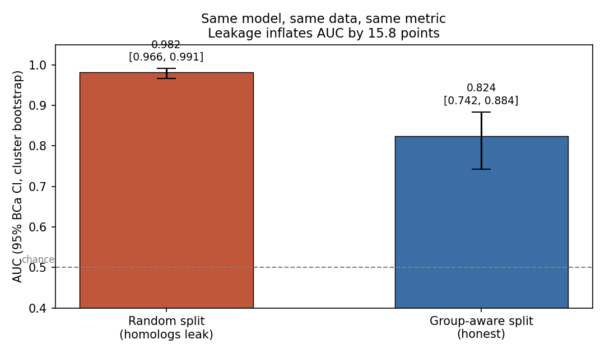

# bio-ml-eval-protocols

**A checklist and a Python package for evaluating machine-learning models on biological data.**

[](https://github.com/GDanielGzz/bio-ml-eval-protocols/actions/workflows/ci.yml)
[](https://www.python.org/)
[](LICENSE)

Many reported gains in biological ML come from a few evaluation mistakes, most
often letting closely related sequences appear in both the training and the test
set. This repository has three short documents describing those mistakes, and
`bioeval`, a small Python package that checks for them, so that a leaking split
raises an error instead of producing a good-looking number.

---

## The problem, reproduced in ten seconds

```bash
pip install -e ".[examples]"
python examples/leakage_inflation.py
```



| Model | AUC [95% CI] | Interval width |
|---|---|---|
| Random split (leaking) | 0.9817 [0.9664, 0.9910] | 0.0246 |
| Group-aware split (no leakage) | 0.8640 [0.7795, 0.9178] | 0.1384 |

Both rows use the same data, model and metric. The random split scores 11.8 AUC
points higher, in line with the 10–15 point drops reported when real
antimicrobial-peptide benchmarks are re-split by sequence cluster. The model did
not improve; it was tested on clusters it had already seen in training.

The interval width matters as well. The leaking split reports an error bar about
five times narrower, because near-identical sequences are counted as independent
test examples.

The demo needs no download or credentials. Its data comes from
`bioeval.datasets.make_clustered_binary`, which generates records in clusters of
near-identical members whose labels depend on the cluster, which is the structure
that causes the problem.

### The same effect on real data

The demo is synthetic so that it runs anywhere.
[**amp-classifier**](https://github.com/GDanielGzz/amp-classifier) applies the
same checks to DRAMP 3.0: MMseqs2 clustering at 40% identity, 1,969 held-out
sequences from clusters not used in training, and bootstrap confidence intervals
on every metric. A frozen ESM2-650M model with an MLP head reaches
**AUC 0.919 [0.906-0.931]**; an XGBoost baseline on 428 engineered features
reaches **0.864 [0.845-0.880]**. The intervals do not overlap for AUC or MCC.

The package grew out of that project. Its `ml/scripts/make_clusters.py`,
`make_splits.py` and `ml/eval_common.py` became `bioeval.splits`,
`bioeval.leakage` and `bioeval.bootstrap` here, generalised from one dataset to
any clustered data.

---
## Quickstart

```python
from sklearn.ensemble import RandomForestClassifier
from sklearn.metrics import roc_auc_score
from bioeval import grouped_split, audit_split, bootstrap_ci, paired_bootstrap

# 1. Split so that no identity cluster spans the boundary.
train, test = grouped_split(clusters, test_size=0.2, seed=0)

# 2. Check it. Raises an error if any cluster is on both sides.
audit_split(train, test, groups=clusters, records=sequences).raise_if_leaking()

# 3. Report a confidence interval, resampling clusters rather than rows.
model = RandomForestClassifier().fit(X[train], y[train])
scores = model.predict_proba(X[test])[:, 1]
ci = bootstrap_ci(y[test], scores, roc_auc_score,
                  groups=clusters[test], method="bca")
print(ci)                      # 0.8640 [0.7795, 0.9178]

# 4. Compare paired, and accept a tie when it is one.
result = paired_bootstrap(y[test], scores, baseline_scores, roc_auc_score,
                          groups=clusters[test],
                          label_a="transformer", label_b="xgboost")
print(result.sentence())
# "transformer (0.8640) and xgboost (0.8592) are statistically tied:
#  the paired difference is +0.0048 [-0.0210, +0.0301] (95% CI),
#  which contains zero."
```

### What's in the package

| Module | Purpose |
|---|---|
| `bioeval.splits` | `grouped_split`, `grouped_kfold`, `group_sizes`: splits where no group crosses the boundary |
| `bioeval.leakage` | `audit_split`, `record_hashes`, `exact_duplicate_pairs`: detect leakage in a split you did *not* construct |
| `bioeval.bootstrap` | `bootstrap_ci` (percentile + BCa, cluster-aware), `paired_bootstrap`: intervals and paired head-to-head tests |
| `bioeval.report` | `results_table`, `comparison_note`: result sentences that stay within the interval |
| `bioeval.datasets` | `make_clustered_binary`: synthetic homologous data so every claim here is reproducible offline |

**`bioeval` does not cluster your data.** Clustering is a domain decision and
belongs to a tool that understands your records, such as MMseqs2, CD-HIT, or
[DataSAIL](https://www.nature.com/articles/s41467-025-58606-8). This package
takes the group labels those produce and guarantees everything downstream
respects them. DataSAIL makes the split; this decides what the numbers mean.

---

## The documents

| Document | What it covers |
|---|---|
| [`methodology_traps.md`](methodology_traps.md) | Five evaluation mistakes: homology leakage, random splits on clustered data, batch confounders, redundancy in public benchmarks, and co-development of method and benchmark. Wrong-vs-right code for each. |
| [`bootstrap_ci_recipe.md`](bootstrap_ci_recipe.md) | A vendor-free `numpy` + `scipy` bootstrap pipeline, including the paired variant and why the across-fold standard deviation is not an error bar. |
| [`negative_results_reporting.md`](negative_results_reporting.md) | A pre-registration checklist and fill-in template for shipping a result that lost to the baseline, with a worked example where a transformer failed to beat gradient-boosted trees. |

---

## Repository contract

Every claim in the documents is executable, and CI fails if one stops being true:

```bash
make test       # 66 tests, including the example scripts end to end
make fast       # unit tests only, skipping the ~1 min example runs
make figures    # regenerate every figure the documents cite
```

The test suite checks the behaviour of the code: that no group ever spans a
split across many seeds, that bootstrap coverage is near nominal, that a row
bootstrap on grouped data really is over-confident, and that two identical
models are called a tie. Tests that only checked return types would pass on an
implementation that leaks.

Two things changed while building it:

- The `grouped_split` seed originally had almost no effect. Sorting clusters
  largest-first made the result nearly independent of it, which would have made
  multi-seed robustness checks meaningless. Shuffled-order packing costs about a
  percentage point of accuracy against the target fraction and was the right
  trade.
- The demonstration was first tuned to a fully nonlinear task, where the group-aware
  AUC came out at 0.52, which is chance level. A 46-point gap looks impressive and proves
  nothing, because an unlearnable task is not evidence about leakage. The
  `nonlinearity` parameter exists so the task stays learnable and the
  remaining gap is attributable.

---

## Why this repository exists

Good tools now exist for building leakage-free splits. Split-construction tools such as
DataSAIL ([Nat. Commun. 2025](https://www.nature.com/articles/s41467-025-58606-8))
make leakage-free splits straightforward, and the over-optimism literature
([Ullmann et al. 2021](https://arxiv.org/pdf/2106.02447);
[Leech et al. 2024](https://arxiv.org/pdf/2407.12220)) has documented the problem
thoroughly, including a 2025 *Briefings in Bioinformatics* review on
out-of-distribution learning
([bbaf294](https://academic.oup.com/bib/article/26/3/bbaf294/8176475)).

What I could not find was a short checklist for the next step: given a leakage-free split, how do you decide what
the numbers mean, and how do you write up a result that lost to the baseline
without burying it?

## Worked examples

All examples use public data only; no unpublished strain data appears here.

- **Cluster-aware splits.** MMseqs2 clustering at 40% identity, from an
  antimicrobial-peptide classifier, where the cluster-aware number is the one reported and the
  random-split number is shown for comparison.
- **A negative transfer-learning result.** A transformer that did not beat an
  XGBoost baseline on bacterial guide-RNA data, written up as an example of
  how to report a clear loss.
- **A non-ML trap.** A genome-scale metabolic-model debugging trail, included
  to show that the same checks apply to a flux-balance model as to a neural net.

## Citing

See [`CITATION.cff`](CITATION.cff).

## License

[MIT](LICENSE).
